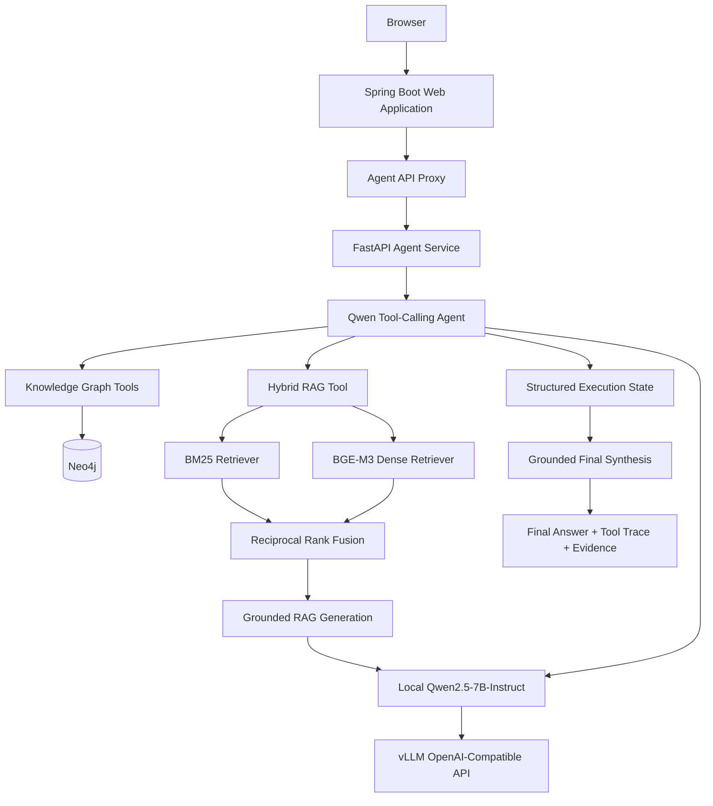

# Pesticide Knowledge Agent

A local-LLM pesticide knowledge assistant that integrates a **Neo4j Knowledge Graph** with **Hybrid RAG**, allowing an LLM agent to autonomously select tools, execute multi-step KG → RAG workflows, and generate grounded answers with citations and execution traces.

The project is upgraded from an existing pesticide knowledge graph and traditional QA system into a modern **RAG + Tool-Calling Agent** architecture.

---

## 1. Project Background

The original system is a pesticide knowledge graph platform built with:

* Spring Boot
* Neo4j
* MySQL
* HTML + Vue + Element UI
* Traditional Bayes-based question answering

The legacy QA module works for relatively fixed query patterns, but has limited ability to handle:

* semantic natural-language queries;
* cross-lingual questions;
* unstructured pesticide descriptions;
* multi-source reasoning;
* multi-step questions involving both graph relations and textual knowledge.

The upgraded system introduces:

1. Hybrid Retrieval;
2. Grounded RAG generation;
3. LLM Tool Calling;
4. Knowledge Graph + RAG multi-step reasoning;
5. Structured Agent State;
6. Local LLM inference with vLLM;
7. Agent evaluation and Web Demo.

---

## 2. System Architecture



The main components are separated into three layers:

* **Web / business layer:** existing Spring Boot pesticide system;
* **Agent / RAG layer:** FastAPI service and Python Agent;
* **LLM inference layer:** local Qwen served through vLLM.

---

## 3. Hybrid RAG

The retrieval system combines lexical and semantic retrieval.

### BM25 Retrieval

BM25 is useful for:

* exact pesticide names;
* active-substance names;
* terminology matching;
* highly specific keywords.

### BGE-M3 Dense Retrieval

`BAAI/bge-m3` is used for semantic retrieval.

It improves retrieval for:

* semantic paraphrases;
* natural-language descriptions;
* mechanism-related questions;
* Chinese-English cross-lingual queries.

### Reciprocal Rank Fusion

The two retrieval lists are merged using Reciprocal Rank Fusion (RRF):

```text
BM25
   \
    → RRF → Top-K Evidence
   /
BGE-M3
```

The current Hybrid Retriever uses a fixed retrieval configuration and retrieves evidence from pesticide active-substance documents.

### Retrieval Evaluation

A frozen 30-query retrieval benchmark covers explicit entity queries, semantic queries, mechanism/resistance questions, and Chinese cross-lingual questions.

| Metric    | Hybrid RRF |
| --------- | ---------: |
| Hit@1     |     0.8000 |
| Hit@3     |     0.9667 |
| Hit@5     |     1.0000 |
| MRR@10    |     0.8639 |
| Recall@5  |     0.8084 |
| Recall@10 |     0.9052 |

---

## 4. Grounded RAG Generation

Retrieved documents are converted into evidence blocks:

```text
[D1]
[D2]
[D3]
...
```

The generation module requires the LLM to answer using retrieved evidence rather than unsupported model knowledge.

The current Grounded RAG pipeline includes:

* evidence-only generation constraints;
* citation preservation;
* citation-label validation;
* entity preservation;
* unsupported negative-inference prevention;
* explicit insufficient-evidence handling.

Example:

```text
Question:
What is the mode of action of spinetoram?

Evidence:
[D1] spinetoram ...

Answer:
Spinetoram acts as a nicotinic acetylcholine receptor
allosteric modulator ... [D1]
```

The generation evaluation uses a frozen 12-query benchmark covering citation behavior, groundedness, insufficient evidence, and Chinese response handling.

Automatic evaluation achieved:

* Citation presence: 100%
* Citation validity: 100%
* Insufficient-evidence handling: 100%
* Chinese-language handling: 100%

Manual evidence-conditioned review found no unsupported claims in the evaluated samples.

---

## 5. Agent Design

The Agent uses an OpenAI-compatible Tool Calling loop.

Current tools include:

### `query_active_substance`

Queries the Knowledge Graph for the active substance of a pesticide product.

Example:

```text
Sparta
→ spinetoram
```

### `query_pesticides_by_active_substance`

Queries pesticide products containing a given active substance.

### `hybrid_rag_query`

Runs:

```text
BM25
+
BGE-M3
+
RRF
+
Grounded Generation
```

and returns:

* answer;
* evidence;
* retrieval trace;
* citation validation result.

---

## 6. Multi-Step KG → RAG Reasoning

The Agent is not limited to selecting a single tool.

For example:

```text
Question:
What is the active substance of Sparta,
and what is its mode of action?
```

The Agent executes:

```text
Step 1 — Knowledge Graph

query_active_substance(
    pesticide_name="Sparta"
)

→ spinetoram
```

The resolved entity is then propagated to the next tool:

```text
Step 2 — Hybrid RAG

hybrid_rag_query(
    question="What is the mode of action of spinetoram?"
)
```

The final answer combines both observations:

```text
The active substance of Sparta is spinetoram.

Spinetoram acts as a nicotinic acetylcholine receptor
(nAChR) allosteric modulator ... [D1]
```

This enables heterogeneous reasoning across structured graph relations and unstructured textual knowledge.

---

## 7. Structured Execution State

A basic Tool-Calling Agent can execute the correct tools while still losing intermediate information during later reasoning or final answer generation.

Two practical failure modes were observed during development:

1. intermediate KG facts could disappear from the final answer;
2. downstream tools could receive ambiguous references such as:

```text
"What is the mode of action of its active substance?"
```

instead of the resolved entity name.

To address this, the Agent maintains structured execution state:

```python
execution_state = {
    "user_question": "...",
    "observations": [
        {
            "tool": "...",
            "arguments": {...},
            "result": ...
        }
    ]
}
```

A lightweight planning state is also provided to subsequent Agent steps.

This allows the Agent to explicitly propagate resolved entities:

```text
Sparta
→ spinetoram
→ query spinetoram
```

rather than relying on ambiguous pronouns.

The final synthesis stage receives:

* the original question;
* tool observations;
* resolved entities;
* RAG evidence;
* candidate answer.

It then produces a grounded final response while preserving valid `[D#]` citations.

---

## 8. Local LLM Deployment

The Agent supports an OpenAI-compatible LLM backend.

The current local setup uses:

* Qwen2.5-7B-Instruct / AWQ;
* vLLM;
* OpenAI-compatible Chat Completion API.

The backend is configured using:

```bash
export LLM_BASE_URL=http://127.0.0.1:8000/v1
export LLM_API_KEY=local
export LLM_MODEL=qwen2.5-7b-instruct
```

The same backend configuration is shared by:

* Agent orchestration;
* Tool selection;
* Grounded RAG generation;
* Final synthesis.

The implementation still supports an OpenRouter-compatible backend when required.

Local deployment removes dependency on free-model API quotas and improves reproducibility for repeated Agent evaluation.

---

## 9. Agent Evaluation

The Agent is evaluated using a frozen 23-query benchmark.

The benchmark contains:

| Category              | Queries |
| --------------------- | ------: |
| Single KG forward     |       3 |
| Single KG reverse     |       2 |
| Single RAG            |       6 |
| KG → RAG multi-step   |       4 |
| KG → KG multi-step    |       2 |
| Chinese cross-lingual |       3 |
| Empty / unknown       |       3 |
| **Total**             |  **23** |

Final regression results with the local Qwen Agent:

| Metric                     | Result |
| -------------------------- | -----: |
| Tool Sequence Exact Match  |   100% |
| Tool Selection Recall      |   100% |
| Unnecessary Tool Call Rate |     0% |
| Entity Preservation        |   100% |
| Citation Presence          |   100% |
| Runtime Error Rate         |     0% |

The benchmark is primarily a **rule-based regression evaluation** for routing, execution consistency, entity preservation, and citation behavior.

**These values should not be interpreted as 100% end-to-end factual accuracy.**

During real multi-step testing, additional failures involving entity propagation and final synthesis were discovered beyond the automatic evaluator and were subsequently addressed through structured execution state.

---

## 10. Web Demo

A Web Agent interface is integrated into the original pesticide knowledge system.

Main page:

```text
/agent.html
```

The interface contains:

### Final Answer

Displays the grounded Agent response and `[D#]` citations.

### Agent Execution Trace

Visualizes the actual Tool Calling process.

Example:

```text
Step 1 · Knowledge Graph

query_active_substance

pesticide_name = Sparta
→ spinetoram
```

```text
Step 2 · Hybrid RAG

hybrid_rag_query

What is the mode of action of spinetoram?
```

### Evidence / Sources

Displays evidence used by the final answer:

```text
[D1] spinetoram
Source: New Zealand pesticide dataset
Retrieval Rank: 1
```

The browser sends requests only to the Spring Boot application:

```http
POST /api/agent/query
```

Spring Boot proxies the request to the FastAPI Agent service.

This avoids exposing internal Agent-service addresses directly to the browser.

---

## 11. API Example

Request:

```http
POST /api/agent/query
Content-Type: application/json
```

```json
{
  "question": "What is the active substance of Sparta, and what is its mode of action?"
}
```

The response contains:

```json
{
  "question": "...",
  "answer": "...",
  "tool_trace": [],
  "execution_state": {}
}
```

`tool_trace` is retained so the Web Demo can visualize the Agent execution process.

---

## 12. Project Structure

```text
PesticideKnowledgeMappingSystem/
├── src/
│   └── main/
│       ├── java/
│       │   └── .../
│       │       └── controller/
│       │           └── AgentController.java
│       │
│       └── resources/
│           └── static/
│               ├── home.html
│               └── agent.html
│
├── rag-agent-service/
│   ├── agent/
│   │   ├── agent_runner.py
│   │   └── tool_registry.py
│   │
│   ├── tools/
│   │   ├── pesticide_query.py
│   │   └── rag_query.py
│   │
│   ├── retrieval/
│   │   ├── bm25_retriever.py
│   │   ├── vector_retriever.py
│   │   └── hybrid_retriever.py
│   │
│   ├── rag/
│   │   └── grounded_rag.py
│   │
│   ├── evaluation/
│   │   ├── agent_evaluator.py
│   │   └── results/
│   │
│   ├── data/
│   └── tests/
│
├── pom.xml
└── README.md
```

---

## 13. Tech Stack

### Agent / LLM

* Qwen2.5-7B-Instruct
* vLLM
* OpenAI-compatible Chat Completion API
* Function / Tool Calling

### Retrieval / RAG

* BM25
* BGE-M3
* Reciprocal Rank Fusion
* Grounded generation
* Citation validation

### Knowledge Graph

* Neo4j
* Cypher
* Pesticide-product / active-substance relations

### Backend

* FastAPI
* Python
* Spring Boot
* Java
* Maven

### Frontend

* HTML
* Vue
* Element UI
* Axios

### Evaluation

* Frozen retrieval benchmark
* Grounded-generation benchmark
* Frozen Agent routing benchmark
* Rule-based regression metrics

---

## 14. Quick Start

### Requirements

Typical environment requirements:

```text
Java 8
Maven
Python 3.11
Neo4j
PyTorch + CUDA
vLLM
Qwen2.5-7B-Instruct
BAAI/bge-m3
```

### Environment Variables

Example:

```bash
export NEO4J_PASSWORD=...
export MYSQL_PASSWORD=...

export LLM_BASE_URL=http://127.0.0.1:8000/v1
export LLM_API_KEY=local
export LLM_MODEL=qwen2.5-7b-instruct
```

Do not commit credentials into the repository.

### Start Services

Start the components in the following order:

```text
1. Neo4j
2. Local Qwen / vLLM service
3. FastAPI Agent service
4. Spring Boot application
5. Open /agent.html
```

Typical local endpoints:

```text
vLLM                 :8000
FastAPI Agent        :8001
Spring Boot Web App  :4399
```

After all services are available, open:

```text
http://localhost:4399/agent.html
```

---

## 15. Project Evolution

```text
Traditional Pesticide Knowledge Graph
                ↓
        Bayes QA Baseline
                ↓
        BM25 Retrieval
                ↓
       BGE-M3 Dense Retrieval
                ↓
       Hybrid RRF Retrieval
                ↓
        Grounded RAG
                ↓
       Agent Tool Integration
                ↓
     KG + RAG Multi-Step Agent
                ↓
     Structured Execution State
                ↓
     Grounded Final Synthesis
                ↓
       Local Qwen Deployment
                ↓
         Web Agent Demo
```

The goal of the project is not to build a general-purpose autonomous agent, but to demonstrate a practical **knowledge-grounded domain Agent** that can coordinate structured and unstructured pesticide knowledge sources in a traceable and reproducible way.
