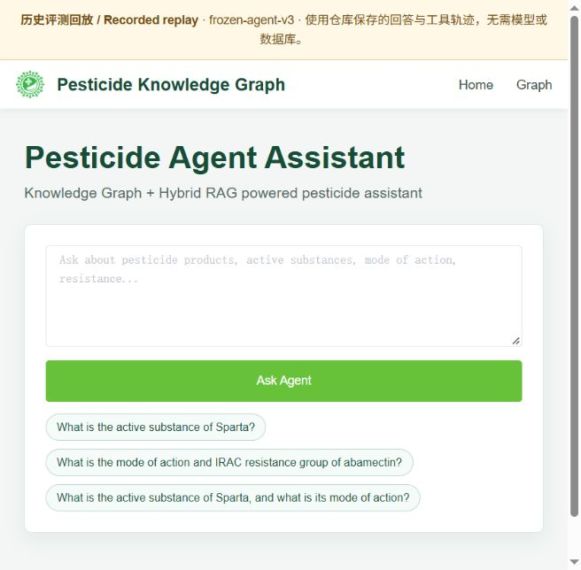
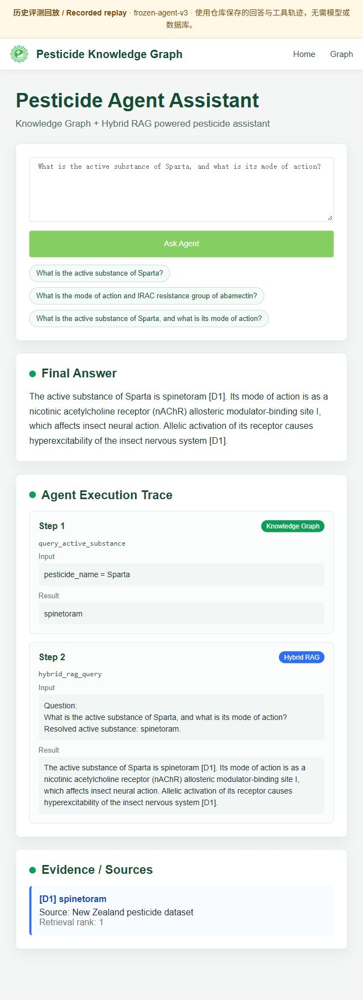
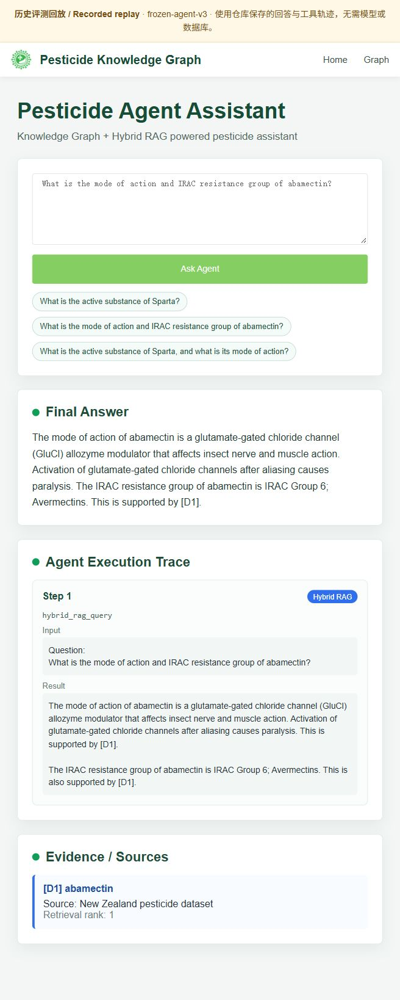
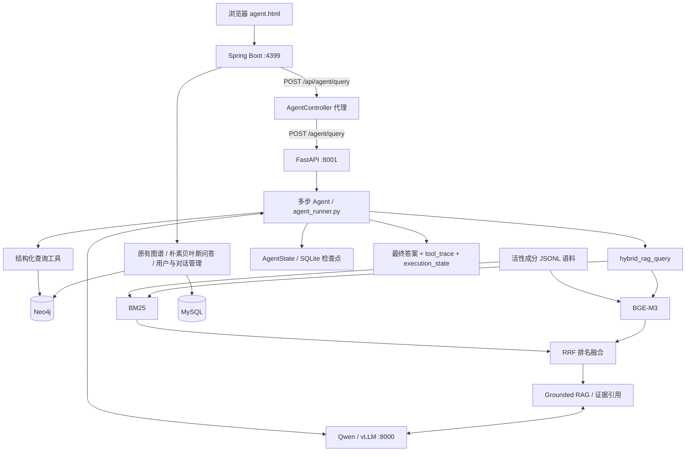

# 农药知识图谱与 RAG 智能问答 Agent

**Pesticide Knowledge Graph Agent** 将 Neo4j 知识图谱、混合检索和大语言模型工具调用结合起来：既能查询“商品名 → 活性成分”等结构化关系，也能根据文档解释作用机制、抗性和背景知识，并展示回答依据与工具执行过程。

项目由原有的 **Spring Boot 农药知识图谱 / 朴素贝叶斯问答系统**扩展而来，新增 **FastAPI + Hybrid RAG + 多步 Tool Calling Agent**，支持本地 Qwen / vLLM 推理。

[演示图片](#演示效果) · [无需模型的本地回放](#快速体验历史评测回放) · [完整运行](#完整系统运行) · [评测结果](#评测结果与边界) · [安全说明](SECURITY.md)

## 演示效果

演示问题：**“Sparta 的活性成分是什么？该成分的作用机制是什么？”**

```text
商品名 Sparta
    ↓ query_active_substance
活性成分 spinetoram
    ↓ hybrid_rag_query（传入上一步解析的准确实体）
检索文档 → 生成带 [D#] 引用的回答
    ↓
最终答案 + 工具轨迹 + 文档来源
```

以下图片使用原有 `agent.html` 页面展示仓库已保存的 `frozen-agent-v3` 评测输出。图片顶部标有**历史评测回放**，本次截图没有调用实时模型或数据库；回放保留原始模型回答及工具结果，不代表人工校正后的事实答案。来源与复现方式见 [演示说明](docs/demo/README.md)。

### 问答入口



### 图谱查询 → RAG 多步问答

一次请求展示三部分：**Final Answer** 是最终回答，**Agent Execution Trace** 展示两次工具调用，**Evidence / Sources** 展示引用文档。



<details>
<summary>查看单独使用 RAG 的演示：abamectin 的作用机制与 IRAC 类别</summary>



</details>

## 快速体验：历史评测回放

只需要 Python 3.9+；无需安装项目依赖、下载模型或启动数据库。

```bash
git clone https://github.com/187815118/Pesticide-Knowledge-Graph-Agent.git
cd Pesticide-Knowledge-Graph-Agent
python scripts/serve_recorded_demo.py
```

打开 **<http://127.0.0.1:8765/agent.html>**，点击页面中的一个示例，再点击 **Ask Agent**。

- 支持商品名查询、RAG 问答和 KG → RAG 多步问答，共三个已保存案例。
- 只回放固定案例；自定义问题需要启动完整系统。
- 服务仅监听本机 `127.0.0.1`，按 `Ctrl+C` 停止。

## 核心能力

| 能力 | 实现方式 |
|---|---|
| 结构化知识查询 | Neo4j / Cypher 查询商品名、活性成分、化学类别、靶点与作用类别 |
| 文本知识检索 | BM25 关键词检索 + BGE-M3 语义检索，通过 RRF 融合排名 |
| 基于证据回答 | Grounded RAG 将检索结果标为 `[D1]`、`[D2]` 等，约束模型引用证据 |
| 多步工具调用 | Agent 根据前一步结果选择下一步工具，传递准确实体名称 |
| 运行状态与恢复 | 保存工具观察、已完成调用和检查点，支持重试、结果复用与任务恢复 |
| 可观察的 Web 界面 | 同时展示最终答案、工具参数/结果和文档来源 |
| 回归与故障评测 | 检索、生成、53 题 Agent 基准和故障注入分别评测 |

这些机制用于减少无依据回答，但不能保证每个回答正确；引用标签合法也不等于被引用内容确实支持该事实。

## 系统架构



Python 服务负责 Agent、工具和 RAG；Java 服务保留原有业务并提供同源代理。浏览器的 Agent 页面只访问 Java 接口；旧版 NeoVis 图谱页面仍采用浏览器直连 Neo4j 的方式，部署约束见 [安全说明](SECURITY.md#旧版图谱页面)。

### 工具划分

| 工具 | 用途 |
|---|---|
| `query_active_substance` | 商品名 → 活性成分 |
| `query_pesticides_by_active_substance` | 活性成分 → 商品名 |
| `query_chemical_classes` | 明确查询图谱中的化学 / 生物类别 |
| `query_target_sites` | 明确查询图谱中的结构化作用靶点 |
| `query_modes_of_action` | 明确查询图谱中的作用类别 |
| `hybrid_rag_query` | 从语料解释 Introduction、作用机制、作用方式、抗性等文本知识 |

普通机制解释优先走 RAG；代码中同时有提示词和路由保护，避免用结构化类别替代文档解释。

## 项目结构与阅读入口

```text
Pesticide-Knowledge-Graph-Agent/
├── src/main/java/.../              Java 控制器、业务服务、实体与数据访问
│   ├── controller/AgentController.java
│   ├── service/NewAnswerService.java
│   └── Naive_Bayes.java
├── src/main/resources/
│   ├── application.yml             数据库和 Web 配置，密码来自环境变量
│   ├── data/*.xlsx                 旧问答模块实际使用的实体词表
│   └── static/agent.html           Agent 页面（含 Vue 交互代码）
├── rag-agent-service/
│   ├── app/main.py                 FastAPI 入口
│   ├── agent/                      Agent 循环、工具注册、结构化状态
│   ├── tools/                      Neo4j 查询与 RAG 工具
│   ├── retrieval/                  语料构建、BM25、向量与 RRF 检索
│   ├── rag/                        基于证据的答案生成
│   ├── runtime/checkpoint_store.py 检查点实现；SQLite 运行文件不入库
│   ├── data/                       RAG 输入语料及冻结评测题
│   ├── evaluation/                 指标、评测入口和已发布结果
│   └── tests/                      mock 测试与环境集成检查
├── legacy-data/naive-bayes/         旧问答仍依赖的词典与分类训练样本
├── docs/                           演示图片、回放案例与审查记录
├── scripts/                        启停服务与本地回放脚本
├── .env.example                    环境变量模板（不会自动加载）
└── pom.xml                         Maven 构建与 Java 依赖
```

推荐先读：`agent.html → AgentController.java → app/main.py → agent_runner.py → tool_registry.py`，再分开学习图谱工具、RAG 和检查点。`runtime/` 和 `legacy-data/` 都包含仍在使用的逻辑或输入，不能按目录名整体删除。

## 完整系统运行

以下命令面向 Linux / Bash，各服务使用独立终端。完整运行需要准备实际数据库、模型和适配 GPU 的推理环境；仓库不附带 Neo4j / MySQL 全量导出、Qwen / BGE-M3 权重，也没有附带构建 RAG 语料所需的原始 CSV。现成的 259 篇 JSONL 语料已在 `rag-agent-service/data/active_substance_docs.jsonl` 中保留。

### 1. 环境与配置

- Java 8、Maven、Python 3.11，以及 Neo4j / MySQL。
- Python Agent 依赖见 `rag-agent-service/requirements.txt`。
- 本地推理还需要适配的 PyTorch / CUDA / vLLM 环境；`requirements.txt` 不包含完整 GPU 推理环境。
- `VectorRetriever` 使用 `local_files_only=True`；需提前准备 `BAAI/bge-m3` 缓存，Agent RAG 工具当前固定使用 CUDA。
- 图谱查询使用已有标签和关系，以及旧式 Neo4j HTTP 事务端点 / Cypher 参数语法。迁移到其他 Neo4j 版本时需核对兼容性。

```bash
python -m pip install -r rag-agent-service/requirements.txt
cp .env.example .env
# 在本机编辑 .env，填写新的数据库凭据；不要提交该文件。

# 每个服务终端均需加载；程序不会自动读取 .env。
set -a
source .env
set +a
```

### 2. 启动模型服务

在已安装 vLLM、且具有所需 GPU 的独立环境中，将 `QWEN_MODEL_PATH` 设置为实际模型目录：

```bash
vllm serve "$QWEN_MODEL_PATH" \
  --served-model-name qwen2.5-7b-instruct \
  --host 127.0.0.1 --port 8000 \
  --enable-auto-tool-choice --tool-call-parser hermes
```

也可使用其他兼容后端，但需要对应设置 `LLM_BASE_URL`、`LLM_API_KEY` 和 `LLM_MODEL`。示例中的 `LLM_API_KEY=local` 仅用于未启用鉴权的本地服务，不是云端 API key。

### 3. 启动 Agent 服务

确保数据库可访问、环境变量已加载、BGE-M3 本地缓存可用：

```bash
uvicorn app.main:app \
  --app-dir rag-agent-service \
  --host 127.0.0.1 --port 8001
```

### 4. 启动 Web / 业务服务

在项目根目录、已加载数据库环境变量的另一个终端运行：

```bash
mvn spring-boot:run
```

打开 **<http://localhost:4399/agent.html>**。

已有 Conda 环境 `pesticide-llm` 和 `pesticide-rag` 时，也可参考 `scripts/start_services.sh` / `scripts/stop_services.sh`。脚本含模型缓存位置和 GPU 编号默认值，需要按机器设置 `MODEL_CACHE`、`LLM_GPU`、`RAG_GPU` 等变量。

### 5. 检查接口

```bash
curl --noproxy '*' http://127.0.0.1:8001/health

curl --noproxy '*' http://127.0.0.1:4399/api/agent/query \
  -H 'Content-Type: application/json' \
  -d '{"question":"What is the active substance of Sparta, and what is its mode of action?"}'
```

响应结构：

```json
{
  "question": "...",
  "answer": "...",
  "tool_trace": [],
  "execution_state": {}
}
```

## 评测结果与边界

下表来自仓库已保存的结果文件，**不是本次重新运行的实验**。此前 README 主要展示 23 题旧基准；当前 Agent 数据集版本为 `frozen-agent-v3`，共有 **53 题**。

| 评测 | 样本与来源 | 已保存结果 |
|---|---|---|
| 混合检索 | 30 题；`retrieval_eval_results.json` | Hit@1 80.00%，Hit@3 96.67%，Hit@5 100.00%，MRR@10 0.8639 |
| Grounded RAG 生成 | 12 题；`rag_generation_eval_results_v1_reviewed.json` | 引用出现率 100%，引用标签有效率 100%，自动规则通过率 **66.67%** |
| 多步 Agent | 53 题；`agent_eval_frozen_v3.json` | 工具序列准确率 **98.11%**，实体传递准确率 100%，引用标签有效率 **92.59%**，答案规则通过率 **86.79%** |
| 故障注入 | 15 个模拟案例；`agent_fault_injection_v1.json` | 已保存重试/恢复成功率 100%，重复执行已成功工具比例 0% |

文件位于 [`rag-agent-service/evaluation/results/`](rag-agent-service/evaluation/results/)。不同指标的适用样本和分母不同；“答案规则通过率”由实体、关键词、引用等确定性规则计算，**不能视为人工确认的端到端事实准确率**。故障注入结果也只适用于这些模拟案例。

运行评测时建议将新结果放进被忽略的 `results/local/`，避免覆盖已发布基线：

```bash
python rag-agent-service/evaluation/run_retrieval_evaluation.py \
  --device cuda --output rag-agent-service/evaluation/results/local/retrieval.json

python rag-agent-service/evaluation/run_agent_evaluation.py \
  --output rag-agent-service/evaluation/results/local/agent.json

PYTHONPATH=rag-agent-service python rag-agent-service/evaluation/agent_fault_eval_runner.py \
  --output rag-agent-service/evaluation/results/local/fault.json
```

检索和完整 Agent 评测需要对应模型 / 数据库环境。生成评测脚本目前单独使用 OpenRouter 配置，需参考其参数与 `OPENROUTER_API_KEY`；不要把它误认为自动继承本地 vLLM 配置。

## 凭据与公开部署

- 数据库密码和云端 API key 通过环境变量传入；`.env`、本地 NeoVis 配置、私钥和运行数据库均不应提交。
- 旧图谱页面的硬编码凭据已从本次修改中移除；旧凭据仍需更换，历史提交也需要单独处理。
- 当前工程是研究 / 本地演示系统。公开部署前需补充认证、访问控制和日志脱敏；不要直接把现有数据库或演示服务暴露到公网。

处理清单及范围见 [安全说明](SECURITY.md) 和 [2026-10-20 仓库审查记录](docs/SECURITY_AUDIT_2026-10-20.md)。
